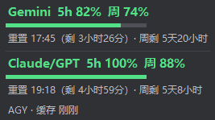

# AGY 额度浮窗 (agy_monitor)



Windows 置顶小浮窗 + 系统托盘，实时显示 Antigravity (`agy`) 各模型分组（如 `Gemini`、`Claude/GPT`）的 5 小时与周剩余额度、进度条及重置倒计时。纯 Python 标准库，无第三方依赖。

## 前置条件

- Windows 系统
- 已安装 Python 3（含标准库 `tkinter`，支持 `pythonw` 或 `pyw`）
- 已安装并登录官方 Antigravity CLI（`agy`）

## 启动

双击 `agy_monitor.bat` 即可无控制台启动；重复运行会自动重启旧实例，不影响其他 `pythonw` 进程。

> 如需指定特定 Python 解释器，可设置环境变量 `AGY_MONITOR_PYTHONW` 为对应 `pythonw.exe` 路径。

## 操作

| 操作 | 效果 |
|---|---|
| 按住浮窗任意位置拖动 | 移动位置（自动记忆到 `position.json`） |
| 右键（浮窗或托盘图标） | 菜单：显示 / 隐藏 / 重置位置 / 强制刷新 / 退出 |
| 托盘图标左键 | 显示并置顶浮窗 |

- 仅通过官方命令 `agy --print /usage --output-format json` 查询额度，不消耗模型 token，不读取 OAuth 凭据。
- 调用 `agy` 时默认注入 `AGY_CLI_DISABLE_AUTO_UPDATE=1`：浮窗只查额度，不触发 CLI 自更新（新版本会整包下载约 230 MiB）。需要让浮窗代为升级时，设置环境变量 `AGY_CLI_DISABLE_AUTO_UPDATE=0` 即可覆盖。
- 界面每 60 秒刷新一次倒计时，实时查询结果缓存 5 分钟并持久化到 `last_snapshot.json`，重启时先展示本地缓存。
- 置顶被其他窗口遮挡会自动恢复。

## 配置与代理

直接编辑同目录的 `config.json` 并重新运行 `agy_monitor.bat` 即可生效：

```json
{
  "proxy": "",
  "project": "",
  "scale": 1.0,
  "opacity": 0.95,
  "refresh_seconds": 60,
  "live_ttl_seconds": 300
}
```

- `proxy`：默认留空，继承系统代理与当前环境变量（适合直连、TUN 模式或已开启系统代理的场景）；若代理客户端未开启系统代理，可填如 `"http://127.0.0.1:7897"`。
- `project`：默认留空；如需绑定已有 Antigravity 项目（避免 `agy` CLI 重建默认 `CLI Project`），填入项目名或项目 ID。
- 其余字段控制界面缩放、透明度、轮询与缓存间隔。
- 如需在本机覆盖配置且不改动受 Git 跟踪的 `config.json`，可新建同目录 `config.local.json`（已被 `.gitignore` 忽略）；加载优先级为 **环境变量（`AGY_MONITOR_PROXY` / `AGY_MONITOR_PROJECT`） > `config.local.json` > `config.json` > 内置默认值**。
